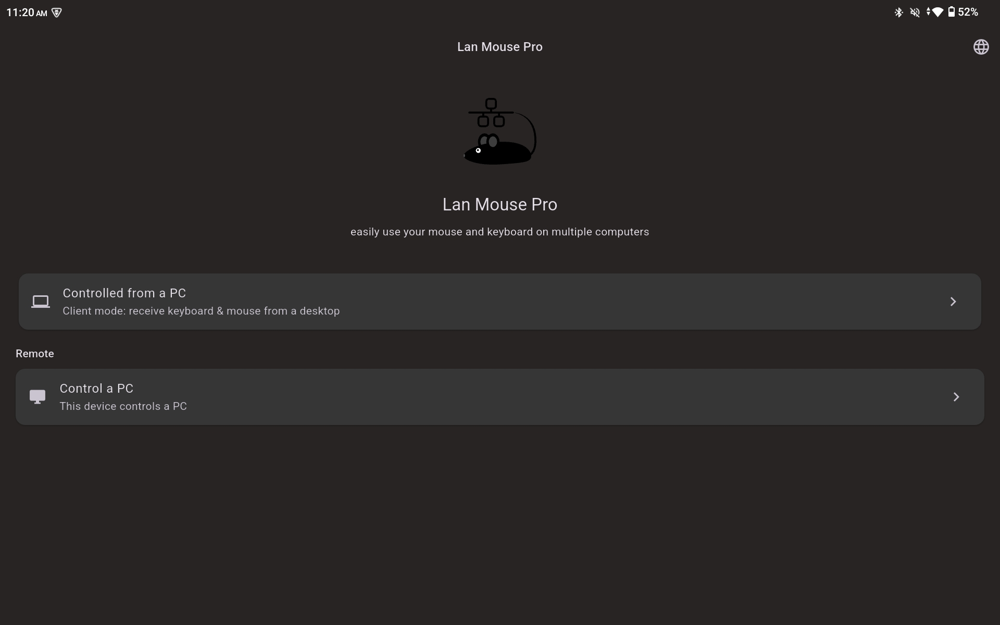
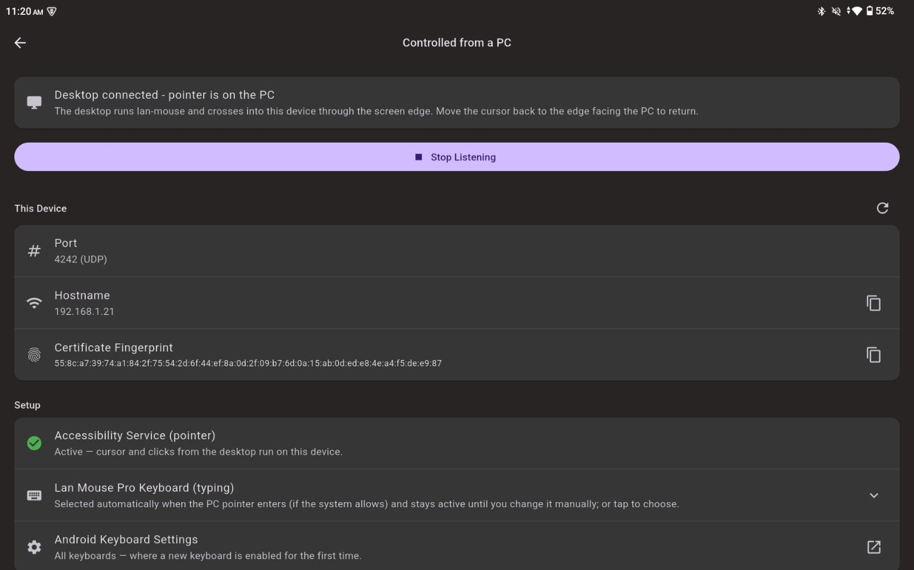

# Lan Mouse Pro

**Lan Mouse Pro** is a fork of [lan-mouse-mobile](https://github.com/rohitsangwan01/lan-mouse-mobile), a mobile client for [Lan Mouse](https://github.com/feschber/lan-mouse). The original app lets a phone *control* a desktop; this fork keeps that mode and adds the reverse direction — **the desktop controls the phone** — plus clipboard sharing, full keyboard-shortcut support, and an Indonesian/English UI.

> Built on the Lan Mouse protocol by the [lan-mouse](https://github.com/feschber/lan-mouse) project. The desktop side is the upstream `lan-mouse` daemon, unchanged.

<p align="center">
  
  
</p>

## Features

**Control a PC (original mode)**
- Use the phone as a touchpad + keyboard for a desktop running Lan Mouse.

**Controlled from a PC (new in this fork)**
- The desktop's physical keyboard and mouse cross into the phone over Wi-Fi (DTLS, same protocol and port 4242 as upstream).
- Overlay cursor with tap / long-press right-click / drag / scroll (rendered as swipes — Android's Accessibility API has no scroll-wheel or hover events).
- Typing through a dedicated input method, including **Ctrl/Shift/Alt shortcuts** (Ctrl+A/C/V/X, Ctrl+Backspace, Shift+selection, F1–F12). Modifier state is tracked from the modifier key events themselves, because some compositors deliver empty `KeyboardModifiers` events.
- The keyboard switches to Lan Mouse automatically when the pointer enters, and stays until changed manually.
- Return crossing: push the cursor back out through the edge facing the PC.
- Listening runs as a foreground service (persistent notification with a Stop action), so the session survives the app being swiped from Recents.

**Clipboard sharing (new)**
- The Lan Mouse protocol has no clipboard messages, so a small PC-side helper (`tools/clipboard_helper.py`, runs as a systemd user service) syncs text clipboards with the app over UDP 4243: copy on the PC → paste on the phone; copy on the phone → move the pointer back → paste on the PC.

**UI**
- Indonesian and English, switchable from the language icon in the top bar; follows the device language by default.

## Getting Started

Download the app from the [Releases](https://github.com/arosyihuddin/lan-mouse-mobile-pro/releases) section, and run [Lan Mouse](https://github.com/feschber/lan-mouse) on the desktop. Phone and desktop must be on the same network.

**To control the PC:** add a client in the app (the desktop's IP) and tap it.

**To be controlled by the PC:**
1. In the app, open *Controlled from a PC* and start listening.
2. Enable the *Lan Mouse Pro Client Input* accessibility service (draws the cursor) and the *Lan Mouse Pro Keyboard* input method (typing) when Android asks.
3. On the desktop, add a client with this device's IP, port 4242, and the position where the device sits relative to the monitor.
4. The first time it connects, compare the certificate fingerprint shown on the desktop with the one in the app, then authorize it.
5. Move the desktop pointer across the screen edge toward the device.

**Clipboard (optional):** on the PC, run the one-line installer once:

```sh
curl -fsSL https://raw.githubusercontent.com/arosyihuddin/lan-mouse-mobile-pro/main/tools/install-clipboard-helper.sh | sh
```

It installs the helper as a systemd user service — no repo clone, no manual downloads. Remove it with:

```sh
curl -fsSL https://raw.githubusercontent.com/arosyihuddin/lan-mouse-mobile-pro/main/tools/install-clipboard-helper.sh | sh -s -- uninstall
```

From a clone, `make clipboard-install` and `make clipboard-uninstall` do the same thing.

It watches the PC clipboard with `wl-paste` and applies text from the phone with `wl-copy`.

## Developer's Guide

Prerequisites: [Flutter](https://flutter.dev/get-started/install) SDK, Android SDK, and a Rust toolchain with the Android targets (`aarch64-linux-android`, `armv7-linux-androideabi`, `x86_64-linux-android`) — the protocol/transport core is Rust via flutter_rust_bridge.

- Run/debug: `flutter pub get`, then `flutter run`.
- Release APK: build with Gradle from `android/` (`gradle assembleRelease`) — in this project's setup the direct Gradle route is the reliable one.
- PC clipboard helper: `tools/clipboard_helper.py` (Python 3, stdlib only, needs `wl-clipboard` on Wayland).

## License

Lan Mouse Pro is free software, licensed under the **GNU General Public License v3.0** — see [LICENSE](LICENSE). It is a derivative work of GPL-3.0 projects, so the whole work, including the modifications in this fork, remains under GPL-3.0: if you distribute the app (for example the APK), the corresponding source code must be made available under the same license.

Attribution:
- Original mobile app: [rohitsangwan01/lan-mouse-mobile](https://github.com/rohitsangwan01/lan-mouse-mobile)
- Lan Mouse protocol and desktop: [feschber/lan-mouse](https://github.com/feschber/lan-mouse)

Main modifications in this fork: reversed client mode (desktop → phone input), clipboard sync helper, shortcut-faithful keyboard handling, app renamed to Lan Mouse Pro, Indonesian/English localization.
